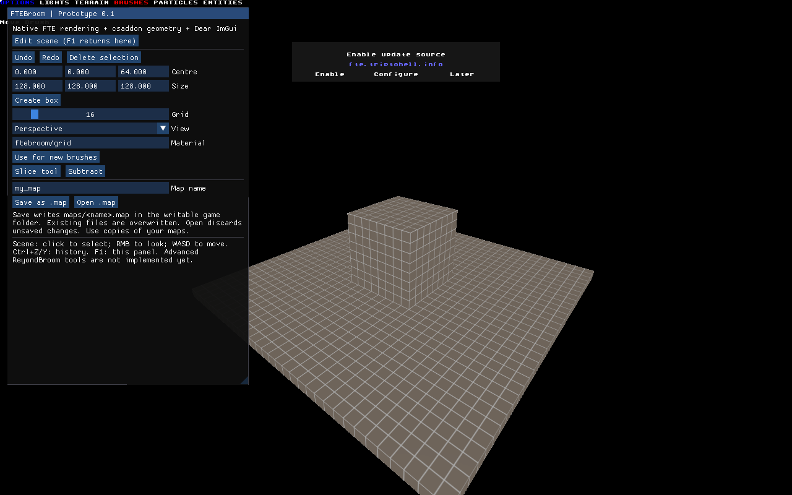

# FTEBroom 0.1 — developer preview

[Русский](README.ru.md) · [Architecture and roadmap](ARCHITECTURE.md)

FTEBroom runs inside FTE Quake. Dear ImGui is compiled into a native FTE plugin; csaddon owns editable brush geometry and undo history. No Qt application, Quake game data or BSP compiler is required for the included sample.

This is the first vertical slice, not a replacement for ReyondBroom yet. Use disposable copies of maps. BSP editing, round-trip preservation of every map dialect, entity workflows and advanced geometry have not been validated.

## Build on Windows

Requirements: Git, PowerShell, MSYS2 installed at C:/msys64 with MinGW64 GCC/G++/make/zlib/libpng/libjpeg-turbo and the standard MSYS shell tools. The default build compiles FTE from the pinned source revision. The older FTE `git-6681-5662b3a23` rendered the UI but failed the surface-metadata round-trip and is not a qualified editor engine.

```powershell
./ftebroom/scripts/build-windows.ps1
```

The script fetches pinned FTE and Dear ImGui revisions, builds the engine, FTEQCC, csaddon and the native plugin, and creates `ftebroom/out/FTEBroom-Windows-x64`. Run `Launch-FTEBroom.cmd` from the output. The preview engine disables Ogg playback and static voice codecs; these are not needed for the first map-editing slice. PNG/JPEG/zlib runtime libraries and notices are included. Engine and ImGui source archives are included. Advanced users may supply `-Engine <path>` to skip engine compilation; that binary must independently pass the smoke test, and its corresponding source must be preserved.

A DLL and `csaddon.dat` alone are not a full application. The launcher uses a dedicated base directory and `-nohome`, so this preview does not edit your normal game installation or settings. Do not build into an existing game directory.

## Using the preview

1. Start the launcher. The sample contains a floor with a bundled grid material.
2. If FTE displays an update-source prompt, choose **Later**. This is FTE's own prompt.
3. Press **F1** to open the ImGui panel. It is rendered over the engine scene, not in another window.
4. Enter a box centre and its three dimensions, then **Create box**. Dimensions must be 1–8192 units and centre coordinates within ±16384. The new brush is selected and enters csaddon's history.
5. Use **Undo**, **Redo**, **Delete selection**, grid size or the perspective/X/Y/Z view selector.
6. Choose **Edit scene** to return mouse/keyboard control to csaddon. F1 reopens the panel. The inherited csaddon overlay remains visible in this iteration.
7. Use **Material** to set the texture for subsequently created brushes. This is a material name, not an asset importer.
8. Enter an ASCII map name (letters, numbers, underscore, hyphen). **Save as .map** writes `ftebroom/maps/<name>.map`; confirm replacement. **Open .map** reloads that file after confirmation and discards unsaved edits.

Scene tools are inherited from csaddon. Mouse selection and manipulation, brush slicing/subtraction, face/vertex operations and patches require their existing csaddon interaction conventions. The new panel exposes only a subset. Ctrl+Z/Y are bound to brush history; WASD controls movement. F1/Escape exits the panel. Input focus is modal in this prototype: the scene cannot be edited while the panel owns input.

## First test checklist

Please test in this order and report the first failing step, FTE version, GPU and a screenshot:

- Launch: the scene and readable ImGui panel appear; choosing Later dismisses an update prompt if present.
- Create: centre `0,0,64`, size `128,128,128` produces one selected cube above the floor.
- History: Undo removes the cube; Redo restores it once. Repeat twice.
- Input: change a numeric field, switch to scene, move/look, and reopen the panel. Check for stuck keys or mouse buttons.
- Views: switch perspective/X/Y/Z and change the grid. Confirm scene selection still works after returning to perspective.
- Files: save as `preview_test`, cancel an Open confirmation once, then confirm Open. The floor and cube should remain. Keep important maps out of this test.
- Report whether Windows display scaling affects panel text or pointer alignment.

Automated smoke testing is available through `scripts/smoke-windows.ps1 -Bundle <output-folder>`. It creates a uniquely named disposable copy, launches FTE, creates a box, exports before/after undo and redo, reloads the export, and compares brush counts and geometry. It does not prove interactive usability.

## Not implemented yet

ReyondBroom Fracture, Perforate, Bevel, Bullet Settle, arrays and other procedural tools; a complete ImGui entity/material browser; docking/multiple simultaneous viewports; unsaved-document tracking; reliable editor camera initialization on every machine; Linux packaging. Existing source in the parent repository does not mean these tools are available in this FTE preview.

## Licenses

See [THIRD-PARTY.md](THIRD-PARTY.md). New FTEBroom code is GPL-2.0-or-later. Upstream csaddon notices are preserved; Dear ImGui is MIT. The GPL text is included in `FTE-LICENSE.txt`.



Actual engine capture; the update-source prompt belongs to FTE.

